<div align="center">

# TUGAS KOMUNIKASI DAN JARINGAN KOMPUTER

## IP SUBNETTING

### CISCO PACKET TRACER


**Nama:** Laily Maulidya Purwanti

**NRP:** 122680025

**Kelas:** S2 Teknik Informatika dan Komputer

**MAGISTER TERAPAN INFORMATIKA DAN KOMPUTER**

**JURUSAN INFORMATIKA DAN KOMPUTER**

**POLITEKNIK ELEKTRONIKA NEGERI SURABAYA**

**2026**

</div>

# 1. Tujuan Praktikum

- Memahami konfigurasi IP address pada router dan PC.

- Memahami tabel routing dan konsep next hop.

- Mengimplementasikan static routing pada dua router.

- Menguji konektivitas jaringan menggunakan perintah ping.

# 2. Dasar Teori

## 2.1 IP Address

IP address merupakan alamat logis yang digunakan untuk mengidentifikasi perangkat dalam jaringan komputer dan memungkinkan komunikasi ant perangkat. Pada IPv4, alamat IP terdiri dari 32 bit yang ditulis dalam empat oktet desimal, seperti `192.168.1.1`. Setiap perangkat yang terhubung ke jaringan harus memiliki konfigurasi IP address yang sesuai agar dapat berkomunikasi dengan perangkat lain.

## 2.2 Subnet Mask

Subnet mask digunakan untuk membedakan bagian network dan bagian host dari sebuah alamat IPv4. Salah satu subnet mask yang umum digunakan adalah `255.255.255.0` atau /24, yang menyediakan 24 bit untuk network dan 8 bit untuk host. Subnet mask membantu perangkat menentukan apakah alamat tujuan berada dalam jaringan yang sama atau harus diteruskan melalui router.

## 2.3 Subnetting

Subnetting merupakan proses membagi suatu blok alamat IP menjadi beberapa jaringan yang lebih kecil. Pembagian ini bertujuan untuk menyesuaikan kebutuhan alamat dengan topologi jaringan serta mempermudah pengelolaan dan proses routing. Setiap subnet memiliki Network ID, rentang alamat host, dan alamat broadcast. Dalam praktikum ini, subnetting digunakan untuk membedakan jaringan LAN pada topologi yang dibuat.

## 2.4 Router dan Routing Table

Router merupakan perangkat jaringan yang meneruskan paket data dari satu jaringan ke jaringan lainnya berdasarkan alamat IP tujuan. Router menggunakan routing table untuk menentukan jalur yang sesuai bagi paket yang akan diteruskan. Routing table dapat memuat jaringan yang terhubung langsung (connected route), rute statis (static route), maupun rute yang dipelajari melalui protokol routing dinamis.

Pada Cisco IOS, kode C pada routing table menunjukkan jaringan yang terhubung langsung ke interface router, sedangkan kode S menunjukkan rute yang dikonfigurasi secara statis.

## 2.5 Static Routing dan Next Hop

Static routing adalah routing yang dilakukan secara manual. Setiap jaringan yang akan dirouting harus dikonfigurasi satu persatu oleh administrator jaringan. Static routing adalah jenis jaringan di mana memerlukan administrator jaringan untuk melakukan konfigurasi secara manual. Fungsi static routing untuk memback-up ketika dynamic routing tiba-tiba mati, dapat mengirim informasi dari protokol satu ke protokol lainnya serta dapat digunakan ketika cakupannya kecil yang hanya memiliki rute kurang dari 5.

Static routing dikenal lebih aman karena pada static routing tidak ada update informasi tabel routing yang dikirimkan ke router lain. Tabel routing adalah kumpulan jalur routing yang telah dikonfigurasi. Informasi yang terdapat dalam tabel routing adalah network destination (jaringan tujuan), subnet mask (subnet mask jaringan tujuan), dan gateway.

Administrator jaringan mengkonfigurasi tabel routing pada setiap perangkat jaringan dengan menambahkan entri statis yang menentukan jalur ke jaringan tujuan tertentu. Entri statis terdiri dari alamat jaringan tujuan dan alamat next-hop (gateway) yang harus digunakan untuk mencapai jaringan tersebut. Ketika perangkat menerima paket untuk diteruskan, ia memeriksa tabel routingnya untuk mencocokkan alamat tujuan paket dengan entri statis dalam tabel routing. Jika ada entri statis yang cocok, perangkat menggunakan next-hop yang ditentukan untuk meneruskan paket ke jaringan tujuan.

Setelah next-hop ditentukan, perangkat meneruskan paket ke next-hop tersebut. Next-hop bisa berupa alamat IP perangkat lain di jaringan yang terhubung secara langsung atau alamat IP dari router berikutnya dalam jalur menuju jaringan tujuan. Dalam static routing, tidak ada pertukaran informasi routing antara perangkat jaringan. Tabel routing diatur secara manual oleh administrator, dan tidak ada perhitungan dinamis untuk menyesuaikan dengan perubahan topologi jaringan.

Konfigurasi ini digunakan ketika router perlu mengetahui jalur menuju jaringan yang tidak terhubung secara langsung. Perintah static route pada Cisco IOS menggunakan format berikut:

```text
ip route network-tujuan subnet-mask next-hop
```

Next hop adalah alamat IP perangkat router berikutnya yang menjadi tujuan penerusan paket menuju jaringan tujuan. Pada topologi yang menggunakan dua router, next hop biasanya berupa alamat IP interface router tetangga yang terhubung melalui jaringan antar-router. Agar komunikasi dua arah dapat berjalan, setiap router perlu memiliki rute menuju jaringan tujuan yang sesuai.

**Keuntungan menggunakan static routing:**

- Meringankan kinerja processor router

- Tidak ada bandwidth yang diguanakn untuk pertukaran informasi dari tabel isi routing pada saat pengiriman paket

- Routing statis lebih aman dibandingkan routing dinamis

- Routing statis kebal dari segala usaha hacker untuk men-spoof dengan tujuan membajak trafik

**Kerugian menggunakan static routing:**

- Administrator jaringan harus mengetahui semua informasi dari masing-masing router yang digunakan

- Hanya dapat digunakan untuk jaringan berskala kecil

- Admisnistrasinya cukup rumit dibanding routing dinamis, terlebih jika banyak router yang harus dikonfigurasi secara manual

- Rentan terhadap kesalahan saat entri data routing statis yang dilakukan secara manual.

## 2.6 Default Gateway

Default gateway merupakan alamat IP interface router yang digunakan perangkat akhir, seperti komputer, untuk mengirim paket ke jaringan lain. Jika alamat tujuan berada di luar subnet lokal, komputer akan meneruskan paket melalui default gateway. Oleh karena itu, konfigurasi default gateway pada setiap PC harus sesuai dengan alamat interface router yang melayani jaringan tersebut.

# 3. Alat dan Bahan

- Laptop/Komputer

- Cisco Packet Tracer

- End devices: PC

- Network devices: Switch, router

- Connections: Copper Straight-Through, Serial DCE

# 4. Langkah Kerja dan Implementasi

## 4.1 Routing dengan Satu Router

### 4.1.1 Topologi Jaringan

Topologi jaringan untuk percobaan satu router ditunjukkan pada gambar berikut.


### 4.1.2 Konfigurasi IP Address, Subnet Mask, dan Default Gateway pada PC

Contoh konfigurasi IP address pada PC ditunjukkan pada tangkapan layar berikut.

**PC0:**

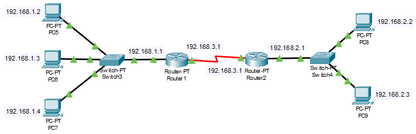

**PC1:**

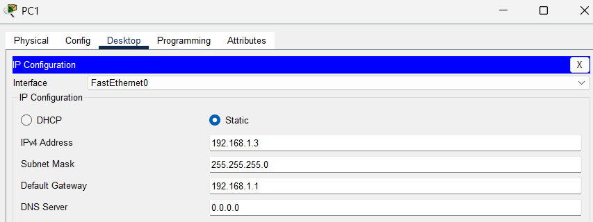

**PC2:**


**PC3:**

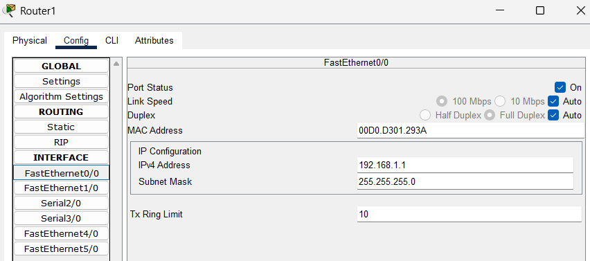

**PC3:**


### 4.1.3 Konfigurasi Router

**Router0:**

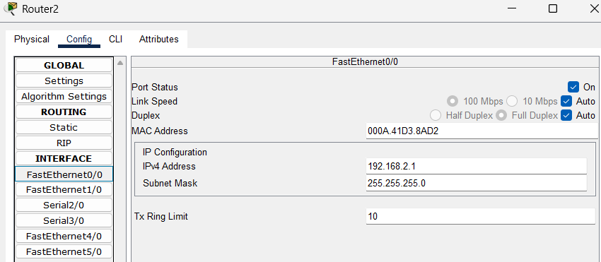

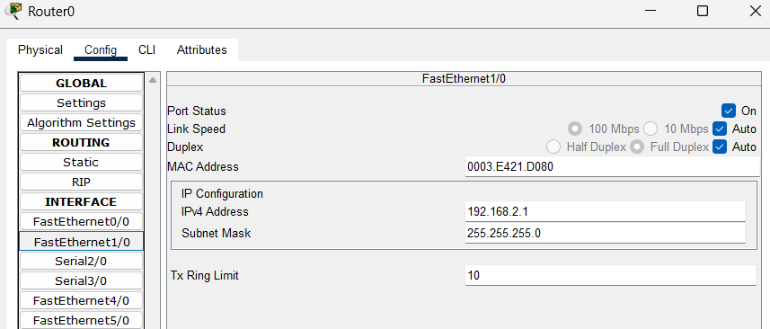

### 4.1.4 Tabel Routing

Berikut adalah tangkapan layar tabel routing yang digunakan sebagai dokumentasi pemeriksaan rute.

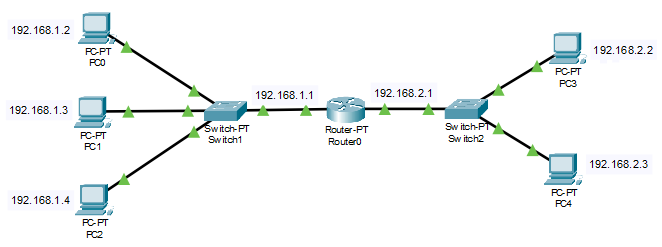

### 4.1.5 Tes Ping

Dokumentasi hasil pengujian konektivitas pada percobaan pertama:

Jaringan yang Sama

PC 0 ke PC 1

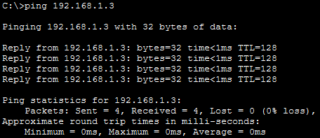

PC 4 ke PC 3

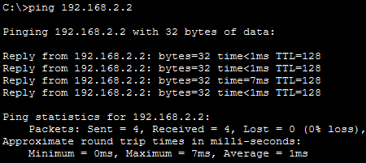

Jaringan Berbeda

PC 1 ke PC 4


PC 3 ke PC 2

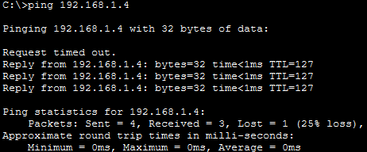

## 4.2 Routing dengan Dua Router

### 4.2.1 Topologi Jaringan

Topologi jaringan untuk percobaan dua router ditunjukkan pada gambar berikut.

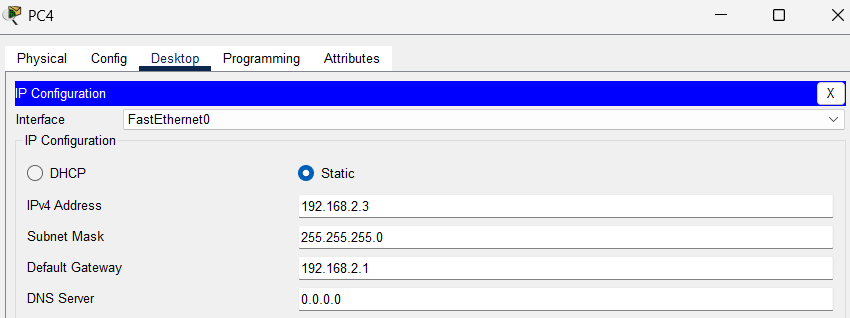

### 4.2.2 Konfigurasi IP Address, Subnet Mask, dan Default Gateway pada PC

Contoh konfigurasi IP address pada PC untuk percobaan dua router:

**PC5:**

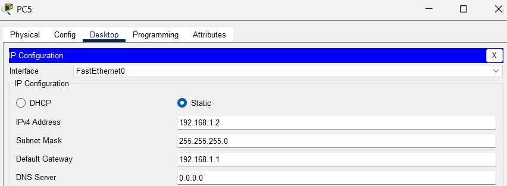

**PC6:**


**PC7:**

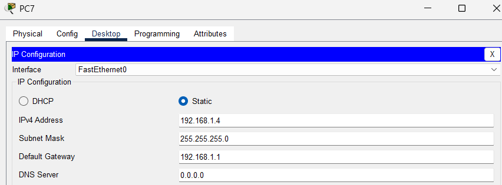

**PC8:**

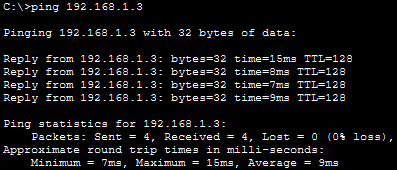

**PC9:**

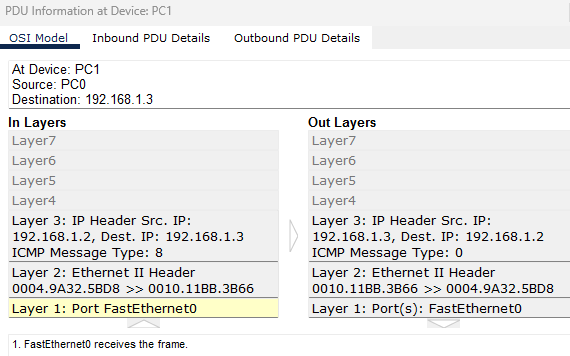

### 4.2.3 Konfigurasi Router

Dokumentasi konfigurasi interface router:

**Router1:**


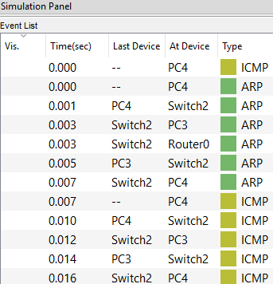

**Router2:**


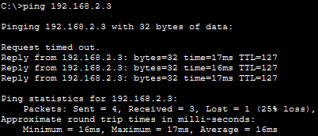

### 4.2.4 Konfigurasi Static Routing

Tangkapan layar konfigurasi rute statis pada router:

**Router1:**

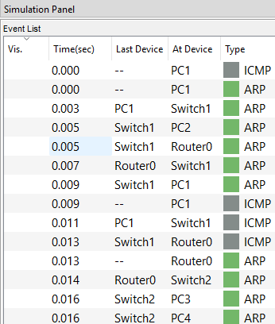

**Router2:**

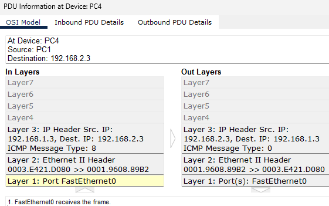

### 4.2.5 Tabel Routing

Hasil pemeriksaan tabel routing setelah static route ditambahkan:

**Router1:**

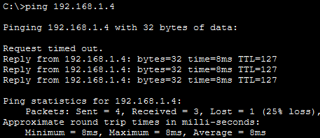

**Router2:**

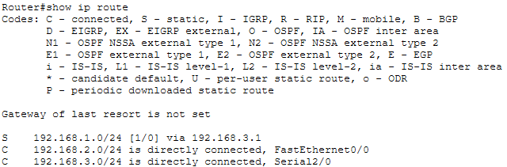

### 4.2.6 Tes Ping

Dokumentasi hasil pengujian ping pada percobaan dua router:

Jaringan yang Sama

PC 6 ke PC 5

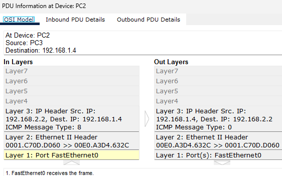

PC 8 ke PC 9

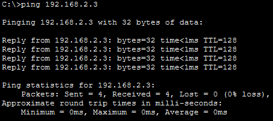

Jaringan Berbeda

PC 7 ke PC 8

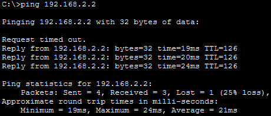

PC 9 ke PC 6


# 5. Hasil dan Pembahasan

## 5.1 Konfigurasi dan Pengujian Jaringan Menggunakan Satu Router

### 5.1.1 Perancangan Topologi Jaringan

Pada percobaan pertama, jaringan komputer dirancang menggunakan satu router yang menghubungkan dua jaringan lokal atau Local Area Network (LAN). Setiap LAN terdiri atas satu switch dan tiga komputer. Switch digunakan untuk menghubungkan beberapa komputer dalam satu jaringan lokal, sedangkan router berfungsi menghubungkan dua jaringan yang memiliki network ID berbeda.

Jaringan pertama menggunakan alamat jaringan `192.168.1.0/24`, sedangkan jaringan kedua menggunakan alamat jaringan `192.168.2.0/24`. Kedua jaringan tersebut dihubungkan melalui dua interface FastEthernet pada router. Interface yang terhubung ke jaringan pertama menggunakan alamat IP `192.168.1.1`, sedangkan interface yang terhubung ke jaringan kedua menggunakan alamat IP `192.168.2.1`.

Penggunaan dua alamat jaringan yang berbeda menyebabkan komunikasi antarkomputer dari kedua LAN perlu melewati router. Komputer yang berkomunikasi dalam jaringan yang sama dapat mengirimkan data melalui switch, sedangkan komunikasi menuju jaringan lain harus diteruskan melalui gateway, yaitu interface router yang terhubung ke jaringan komputer tersebut.

### 5.1.2 Konfigurasi Alamat IP pada Komputer

Tahap pertama dilakukan dengan memberikan alamat IP kepada setiap komputer melalui menu Desktop, kemudian memilih IP Configuration pada Cisco Packet Tracer. Setiap komputer perlu memiliki alamat IP yang unik agar tidak terjadi konflik alamat dalam jaringan.

Sebagai contoh, komputer pada jaringan pertama menggunakan alamat IP `192.168.1.2`, `192.168.1.3`, dan `192.168.1.4`. Sementara itu, komputer pada jaringan kedua menggunakan alamat IP `192.168.2.2`, `192.168.2.3`, dan `192.168.2.4`.

Subnet mask yang digunakan pada kedua jaringan adalah `255.255.255.0` atau /24. Subnet mask tersebut menunjukkan bahwa 24 bit pertama digunakan sebagai bagian network, sedangkan 8 bit sisanya digunakan sebagai bagian host. Dengan demikian, jaringan `192.168.1.0/24` dan `192.168.2.0/24` merupakan dua jaringan yang berbeda.

Selain alamat IP dan subnet mask, setiap komputer juga dikonfigurasi dengan default gateway yang sesuai. Komputer pada jaringan pertama menggunakan gateway `192.168.1.1`, sedangkan komputer pada jaringan kedua menggunakan gateway `192.168.2.1`.

Default gateway berfungsi sebagai tujuan pengiriman paket ketika komputer ingin berkomunikasi dengan alamat IP yang berada di luar jaringan lokalnya. Sebagai contoh, komputer `192.168.1.3` akan menggunakan gateway `192.168.1.1` ketika mengirimkan paket menuju komputer `192.168.2.2`, karena kedua komputer berada pada network ID yang berbeda.

### 5.1.3 Konfigurasi Interface Router

Setelah konfigurasi IP pada komputer selesai, tahap berikutnya adalah memberikan alamat IP pada interface router yang terhubung ke masing-masing jaringan. Konfigurasi dilakukan melalui Command Line Interface (CLI) router.

Interface FastEthernet0/0 dikonfigurasi menggunakan alamat IP `192.168.1.1` dengan subnet mask `255.255.255.0.`
Interface FastEthernet1/0 dikonfigurasi menggunakan alamat IP `192.168.2.1` dengan subnet mask yang sama.

Pada tahap awal pemeriksaan, perintah show ip interface brief menunjukkan bahwa kedua interface masih berada dalam kondisi administratively down. Kondisi tersebut berarti interface dinonaktifkan secara administratif sehingga belum dapat digunakan untuk meneruskan paket data.

Oleh karena itu, setiap interface yang digunakan perlu diaktifkan menggunakan perintah no shutdown. Setelah perintah tersebut diberikan, interface akan mulai diaktifkan. Apabila koneksi fisik atau hubungan antarmuka telah terpasang dengan benar, status interface dapat berubah menjadi up, dan status protokolnya juga menjadi up.

Kondisi up/up menunjukkan bahwa interface aktif dan protokol pada interface tersebut berjalan. Sebaliknya, apabila interface masih menunjukkan status down, koneksi fisik, port yang digunakan, atau konfigurasi lainnya perlu diperiksa kembali.

### 5.1.4 Pemeriksaan Tabel Routing

Setelah interface router aktif, pemeriksaan dilakukan menggunakan perintah show ip route. Perintah tersebut digunakan untuk melihat informasi rute yang diketahui router dan menentukan jalur yang digunakan untuk meneruskan paket menuju jaringan tujuan.

Hasil pemeriksaan menunjukkan adanya dua jaringan yang berstatus directly connected, yaitu:

`192.168.1.0/24` yang terhubung langsung melalui FastEthernet0/0.

`192.168.2.0/24` yang terhubung langsung melalui FastEthernet1/0.

Kedua jaringan tersebut ditandai dengan kode C pada tabel routing. Kode C merupakan singkatan dari Connected, yang berarti jaringan tersebut terhubung secara langsung melalui interface router yang aktif.

Informasi ini menunjukkan bahwa router telah mengenali kedua jaringan lokal dan mengetahui interface yang digunakan untuk menjangkaunya. Karena kedua jaringan terhubung langsung ke satu router, konfigurasi static routing tidak diperlukan pada percobaan ini. Router dapat meneruskan paket antarkedua jaringan berdasarkan informasi rute yang terbentuk secara otomatis dari interface yang aktif.

Dengan demikian, keberhasilan komunikasi pada jaringan satu router bergantung pada ketepatan konfigurasi IP komputer, default gateway, status interface router, serta koneksi antarkomponen.

### 5.1.5 Pengujian Konektivitas Menggunakan Ping

Pengujian konektivitas dilakukan menggunakan perintah ping melalui Command Prompt pada komputer. Perintah tersebut mengirimkan paket ICMP Echo Request menuju alamat IP tujuan, kemudian menunggu balasan berupa ICMP Echo Reply.

Pengujian pertama dilakukan dari komputer dengan alamat IP `192.168.1.3` menuju gateway `192.168.1.1`. Hasil pengujian menunjukkan bahwa komputer dapat menerima balasan dari router. Hal ini membuktikan bahwa komputer dapat menjangkau interface router yang berada pada jaringan lokalnya.

Pengujian berikutnya dilakukan menuju alamat IP `192.168.2.1`, yaitu interface router yang terhubung ke jaringan kedua. Keberhasilan pengujian ini menunjukkan bahwa alamat interface tersebut dapat dijangkau dari jaringan pertama melalui proses penerusan paket oleh router.

Selanjutnya, pengujian dilakukan dari komputer `192.168.1.3` menuju komputer `192.168.2.2`. Hasil pengujian menunjukkan bahwa komputer tujuan dapat memberikan balasan sehingga komunikasi antarkedua jaringan berhasil dilakukan.

Ketika komputer sumber mengirimkan paket menuju `192.168.2.2`, komputer terlebih dahulu membandingkan alamat IP tujuan dengan alamat jaringan lokalnya berdasarkan subnet mask. Karena alamat tujuan berada pada jaringan `192.168.2.0/24`, bukan `192.168.1.0/24`, komputer mengetahui bahwa paket harus dikirimkan melalui default gateway `192.168.1.1`.

Router kemudian memeriksa tabel routing dan menemukan bahwa jaringan tujuan `192.168.2.0/24` terhubung langsung melalui FastEthernet1/0. Paket diteruskan melalui interface tersebut menuju jaringan kedua hingga mencapai komputer tujuan.

Komputer tujuan selanjutnya mengirimkan balasan kepada komputer sumber melalui gateway yang telah dikonfigurasi. Router meneruskan balasan tersebut kembali ke jaringan pertama. Proses ini memungkinkan komunikasi dua arah antara komputer yang berada pada jaringan berbeda.

Keberhasilan pengujian ditunjukkan oleh munculnya balasan Reply from pada hasil ping. Informasi tersebut menunjukkan bahwa paket ICMP Echo Request telah mencapai tujuan dan balasan ICMP Echo Reply berhasil diterima oleh komputer sumber.

### 5.1.6 Analisis Proses ARP pada Jaringan Satu Router

Selain proses routing, komunikasi jaringan juga melibatkan Address Resolution Protocol (ARP). ARP digunakan untuk mengetahui alamat MAC perangkat yang memiliki alamat IPv4 tertentu pada jaringan lokal.

Ketika komputer `192.168.1.3` hendak mengirimkan paket menuju `192.168.2.2`, komputer tidak langsung mencari alamat MAC komputer tujuan pada jaringan kedua. Karena alamat tujuan berada di luar jaringan lokal, komputer perlu mengetahui alamat MAC dari default gateway, yaitu `192.168.1.1`.

Apabila informasi alamat MAC gateway belum tersedia di ARP cache, komputer mengirimkan ARP Request melalui jaringan lokal. Permintaan tersebut digunakan untuk mencari perangkat yang memiliki alamat IP `192.168.1.1`. Router kemudian memberikan ARP Reply yang berisi alamat MAC interface-nya pada jaringan pertama.

Setelah memperoleh alamat MAC gateway, komputer dapat mengirimkan frame Ethernet yang berisi paket IP menuju router. Router memeriksa alamat IP tujuan, menentukan jalur berdasarkan tabel routing, lalu meneruskan paket melalui interface yang terhubung ke jaringan kedua.

Pada jaringan kedua, router juga perlu mengetahui alamat MAC komputer tujuan `192.168.2.2`. Jika informasi tersebut belum tersedia di ARP cache router, router mengirimkan ARP Request pada jaringan kedua. Komputer tujuan memberikan ARP Reply sehingga router dapat mengirimkan frame Ethernet kepada komputer tersebut.

Dengan demikian, ARP membantu proses pengiriman frame pada setiap jaringan lokal yang dilalui. Sementara itu, routing menentukan jaringan tujuan dan interface yang digunakan untuk meneruskan paket IP. Keduanya memiliki fungsi berbeda, tetapi saling mendukung dalam proses komunikasi antarkomputer.

Perlu diperhatikan bahwa proses ARP tidak selalu terjadi setiap kali ping dilakukan. Apabila alamat MAC perangkat tujuan sudah tersimpan di ARP cache, perangkat dapat menggunakan informasi tersebut tanpa mengirimkan ARP Request kembali.

### 5.1.7 Analisis Hasil Kasus Satu Router

Berdasarkan seluruh pengujian, jaringan yang menggunakan satu router berhasil menghubungkan dua LAN dengan network ID berbeda. Konfigurasi IP pada komputer, default gateway, serta interface router memungkinkan paket dikirimkan dari jaringan `192.168.1.0/24` menuju jaringan `192.168.2.0/24` dan kembali ke jaringan asal.

Tabel routing menunjukkan bahwa kedua jaringan telah dikenali sebagai jaringan yang terhubung langsung. Oleh karena itu, router tidak memerlukan static route tambahan untuk menghubungkan kedua LAN tersebut.

Hasil ping yang berhasil dan menampilkan balasan dengan nilai TTL menunjukkan bahwa komunikasi ICMP telah berlangsung dengan baik. Nilai TTL (Time To Live) merupakan batas umur paket IP yang dikurangi oleh perangkat router ketika paket diteruskan. Tujuannya adalah mencegah paket beredar tanpa batas apabila terjadi kesalahan routing.

Nilai TTL yang ditampilkan pada hasil ping umumnya berasal dari paket balasan yang diterima komputer sumber. Nilai tersebut bukan ukuran langsung kualitas jaringan, melainkan informasi mengenai sisa TTL pada paket balasan ketika tiba di komputer sumber.

Secara keseluruhan, percobaan pertama menunjukkan bahwa satu router sudah dapat digunakan untuk menghubungkan dua jaringan lokal selama setiap interface memiliki konfigurasi IP yang sesuai, berada dalam kondisi aktif, dan setiap komputer menggunakan default gateway yang benar.

## 5.2 Konfigurasi dan Pengujian Jaringan Menggunakan Dua Router dengan Static

Routing

### 5.2.1 Perancangan Topologi Jaringan

Pada percobaan kedua, topologi jaringan dikembangkan dengan menggunakan dua router untuk menghubungkan dua jaringan lokal. Masing-masing LAN memiliki satu switch dan tiga komputer. Perbedaan utama dari percobaan pertama adalah kedua jaringan lokal tidak lagi terhubung ke satu router yang sama, tetapi masing-masing terhubung ke router yang berbeda.

Router pertama, selanjutnya disebut R1, menghubungkan jaringan `192.168.1.0/24`. Router kedua, selanjutnya disebut R2, menghubungkan jaringan `192.168.2.0/24`. Kedua router dihubungkan melalui jaringan transit `192.168.3.0/24`.

Dalam rancangan ini, interface R1 yang mengarah ke jaringan pertama menggunakan alamat IP `192.168.1.1`, sedangkan interface R2 yang mengarah ke jaringan kedua menggunakan alamat IP `192.168.2.1`. Pada jaringan transit, R1 menggunakan alamat IP `192.168.3.1` dan R2 menggunakan alamat IP `192.168.3.2`.

Jaringan transit berfungsi sebagai jalur komunikasi antara kedua router. Dengan adanya jaringan tersebut, paket dari komputer pada LAN pertama dapat diteruskan ke R1, kemudian dikirimkan ke R2 sebelum mencapai komputer tujuan pada LAN kedua.

Karena setiap router hanya terhubung langsung dengan LAN lokalnya dan jaringan transit, kedua router perlu memiliki informasi tentang jaringan yang tidak terhubung secara langsung. Informasi tersebut ditambahkan melalui konfigurasi static routing.

### 5.2.2 Konfigurasi Alamat IP pada Komputer

Seperti pada percobaan pertama, setiap komputer dikonfigurasi melalui menu Desktop dan IP Configuration. Komputer pada jaringan pertama menggunakan alamat IP dalam rentang `192.168.1.0/24`, sedangkan komputer pada jaringan kedua menggunakan alamat IP dalam rentang `192.168.2.0/24`.

Sebagai contoh, komputer sumber menggunakan alamat IP `192.168.1.3` dengan subnet mask `255.255.255.0` dan default gateway `192.168.1.1`. Komputer tujuan menggunakan alamat IP `192.168.2.2` dengan subnet mask yang sama dan default gateway `192.168.2.1`.

Konfigurasi default gateway harus disesuaikan dengan router yang terhubung langsung ke LAN masing-masing. Komputer pada LAN pertama menggunakan R1 sebagai gateway, sedangkan komputer pada LAN kedua menggunakan R2 sebagai gateway.

Kesalahan dalam menentukan default gateway dapat menyebabkan komputer tidak dapat mengirimkan paket ke jaringan di luar jaringan lokalnya, meskipun alamat IP dan subnet mask sudah benar.

### 5.2.3 Konfigurasi Interface pada Kedua Router

Tahap berikutnya adalah mengonfigurasi interface pada R1 dan R2. Setiap interface yang terhubung ke LAN maupun jaringan transit harus memiliki alamat IP yang sesuai dengan subnet tempat interface tersebut berada.

Pada R1, interface yang mengarah ke LAN pertama dikonfigurasi menggunakan alamat IP `192.168.1.1/24`, sedangkan interface yang mengarah ke jaringan transit menggunakan alamat IP `192.168.3.1/24`.

Pada R2, interface yang mengarah ke LAN kedua dikonfigurasi menggunakan alamat IP `192.168.2.1/24`, sedangkan interface yang mengarah ke jaringan transit menggunakan alamat IP `192.168.3.2/24`.

Setelah alamat IP diberikan, interface yang digunakan perlu diaktifkan menggunakan perintah no shutdown. Pemeriksaan dilakukan melalui perintah show ip interface brief untuk memastikan bahwa interface yang digunakan sudah berada dalam kondisi aktif.

Apabila interface menunjukkan status up/up, koneksi antarmuka dan protokolnya telah aktif. Jika status masih administratively down, interface belum diaktifkan. Jika status masih down setelah diaktifkan, koneksi kabel, jenis port, atau kondisi interface pada perangkat lain perlu diperiksa.

Sebelum menambahkan static routing, kedua router harus dapat menjangkau alamat IP pada jaringan transit. Sebagai contoh, R1 perlu dapat menjangkau `192.168.3.2`, sedangkan R2 perlu dapat menjangkau `192.168.3.1`. Pemeriksaan ini membantu memastikan bahwa hubungan antarkedua router telah berfungsi.

### 5.2.4 Pemeriksaan Tabel Routing Sebelum Static Routing

Setelah seluruh interface aktif, pemeriksaan dilakukan menggunakan perintah show ip route pada masing-masing router.

Pada R1, tabel routing seharusnya menunjukkan jaringan `192.168.1.0/24` sebagai jaringan yang terhubung langsung melalui interface LAN pertama dan jaringan `192.168.3.0/24` sebagai jaringan transit yang terhubung langsung.

Pada R2, tabel routing seharusnya menunjukkan jaringan `192.168.2.0/24` sebagai jaringan yang terhubung langsung melalui interface LAN kedua dan jaringan `192.168.3.0/24` sebagai jaringan transit yang terhubung langsung.

Pada tahap ini, R1 belum tentu mengetahui jalur menuju `192.168.2.0/24`, sedangkan R2 belum tentu mengetahui jalur menuju `192.168.1.0/24`. Kedua jaringan tersebut tidak terhubung secara langsung ke masing-masing router.

Kondisi ini berbeda dari percobaan pertama. Pada percobaan pertama, kedua LAN terhubung langsung ke satu router sehingga router secara otomatis memiliki rute menuju keduanya. Pada percobaan kedua, informasi tentang jaringan di belakang router lain perlu ditambahkan secara manual.

### 5.2.5 Konfigurasi Static Routing pada R1 dan R2

Untuk memungkinkan komunikasi antarkedua LAN, static routing dikonfigurasi pada masing-masing router. Static routing merupakan metode penentuan jalur jaringan yang dilakukan secara manual oleh administrator.

Pada R1, ditambahkan rute menuju jaringan `192.168.2.0/24` melalui next hop `192.168.3.2`, yaitu alamat interface R2 pada jaringan transit. Perintah yang digunakan adalah:

```text
ip route 192.168.2.0 255.255.255.0 192.168.3.2
```

Perintah tersebut memiliki tiga bagian utama. Alamat `192.168.2.0` menunjukkan jaringan tujuan, `255.255.255.0` merupakan subnet mask jaringan tujuan, dan `192.168.3.2` merupakan alamat next hop yang akan menerima paket dari R1 untuk diteruskan ke jaringan tujuan.

Pada R2, ditambahkan rute menuju jaringan `192.168.1.0/24` melalui next hop `192.168.3.1`. Perintah yang digunakan adalah:

```text
ip route 192.168.1.0 255.255.255.0 192.168.3.1
```

Konfigurasi tersebut diperlukan agar R2 mengetahui bahwa paket yang ditujukan ke jaringan `192.168.1.0/24` harus diteruskan melalui R1.

Static route perlu dikonfigurasi pada kedua router karena komunikasi membutuhkan jalur pergi dan jalur kembali. Jika hanya R1 yang memiliki rute menuju jaringan kedua, paket dari komputer sumber mungkin berhasil mencapai komputer tujuan, tetapi balasan dari komputer tujuan dapat gagal kembali ke jaringan pertama apabila R2 tidak memiliki rute yang sesuai.

Setelah konfigurasi selesai, perintah show ip route digunakan kembali untuk memeriksa hasilnya. Rute static biasanya ditandai dengan kode S. Pada R1, seharusnya terdapat rute menuju `192.168.2.0/24` melalui `192.168.3.2`. Sementara itu, pada R2 seharusnya terdapat rute menuju `192.168.1.0/24` melalui `192.168.3.1`.

Munculnya rute tersebut menunjukkan bahwa masing-masing router telah memiliki informasi jalur menuju jaringan lokal yang berada di belakang router lainnya.

### 5.2.6 Pengujian Konektivitas Menggunakan Ping

Setelah konfigurasi static routing selesai, pengujian dilakukan menggunakan perintah ping dari komputer sumber `192.168.1.3` menuju komputer tujuan `192.168.2.2`.

Pada pengujian awal, hasil ping menunjukkan pesan Request timed out. Pesan tersebut berarti komputer sumber tidak menerima balasan ICMP Echo Reply dalam batas waktu yang ditentukan. Namun, pesan ini tidak secara langsung membuktikan bahwa konfigurasi jaringan salah atau bahwa paket pasti gagal mencapai komputer tujuan.

Pada percobaan ini, ping berikutnya menunjukkan balasan Reply from beserta informasi TTL. Hasil tersebut menunjukkan bahwa komunikasi antara kedua komputer akhirnya berhasil dilakukan.

Ketika komputer sumber mengirimkan paket pertama, komputer terlebih dahulu memeriksa apakah alamat IP tujuan berada dalam jaringan lokal. Karena `192.168.2.2` berada pada jaringan `192.168.2.0/24`, sedangkan komputer sumber berada pada jaringan `192.168.1.0/24`, paket dikirimkan melalui default gateway `192.168.1.1`.

R1 kemudian memeriksa tabel routing. Karena telah memiliki static route menuju `192.168.2.0/24` melalui `192.168.3.2`, R1 meneruskan paket melalui jaringan transit menuju R2.

Setelah menerima paket, R2 memeriksa alamat IP tujuan dan menemukan bahwa jaringan `192.168.2.0/24` terhubung langsung melalui interface LAN-nya. Paket kemudian diteruskan menuju komputer `192.168.2.2`.

Komputer tujuan memproses permintaan ICMP tersebut dan mengirimkan balasan kepada komputer sumber. Untuk mengirimkan balasan ke jaringan `192.168.1.0/24`, komputer tujuan menggunakan default gateway `192.168.2.1`. R2 selanjutnya menggunakan static route menuju `192.168.1.0/24` melalui `192.168.3.1`, kemudian meneruskan paket kepada R1. R1 mengirimkan balasan ke jaringan pertama hingga mencapai komputer sumber.

Ketika komputer sumber menerima ICMP Echo Reply, hasil ping menampilkan Reply from beserta waktu respons dan nilai TTL. Hal tersebut membuktikan bahwa jalur komunikasi dari komputer sumber menuju komputer tujuan dan jalur balasan menuju komputer sumber telah berfungsi.

### 5.2.7 Analisis Penyebab Ping Pertama Mengalami Request Timed Out

Pada percobaan dua router, ping pertama mengalami Request timed out, sedangkan ping berikutnya berhasil. Salah satu kemungkinan penyebabnya adalah proses resolusi alamat MAC menggunakan Address Resolution Protocol (ARP), terutama apabila perangkat belum memiliki informasi alamat MAC yang diperlukan di dalam ARP cache.

ARP diperlukan karena komunikasi pada jaringan Ethernet menggunakan alamat MAC untuk mengirimkan frame ke perangkat berikutnya. Alamat IP digunakan untuk mengidentifikasi sumber dan tujuan pada lapisan jaringan, sedangkan alamat MAC digunakan untuk pengiriman frame pada jaringan lokal.

Pada tahap awal, komputer sumber `192.168.1.3` perlu mengetahui alamat MAC interface gateway `192.168.1.1`. Jika informasi tersebut belum tersimpan, komputer mengirimkan ARP Request untuk mencari alamat MAC gateway. R1 memberikan ARP Reply setelah menerima permintaan tersebut.

Selanjutnya, ketika R1 hendak meneruskan paket ke R2 melalui jaringan transit, R1 perlu mengetahui alamat MAC next hop `192.168.3.2`. Jika alamat MAC tersebut belum tersedia, R1 melakukan proses ARP pada jaringan transit. R2 kemudian memberikan informasi alamat MAC interface-nya pada jaringan tersebut.

Pada sisi jaringan tujuan, R2 juga perlu mengetahui alamat MAC komputer `192.168.2.2` sebelum mengirimkan frame ke komputer tersebut. Jika belum tersedia di ARP cache, R2 melakukan ARP Request dan menunggu ARP Reply dari komputer tujuan.

Dengan demikian, satu pengiriman paket dari komputer sumber ke komputer tujuan dapat melibatkan beberapa proses resolusi ARP pada segmen jaringan yang berbeda. Informasi alamat MAC yang diperoleh kemudian dapat disimpan sementara dalam ARP cache sehingga tidak perlu dicari kembali setiap kali paket dikirimkan.

Apabila proses resolusi alamat MAC berlangsung ketika ping pertama dilakukan, waktu yang diperlukan untuk mengirimkan paket dan menerima balasan dapat menjadi lebih lama. Hal ini dapat menjadi salah satu penjelasan mengapa ping pertama mengalami timeout, sedangkan pengujian berikutnya berhasil setelah informasi alamat MAC tersedia.

Namun, ARP tidak dapat langsung dipastikan sebagai penyebab utama hanya berdasarkan hasil Command Prompt. Pesan Request timed out juga dapat terjadi karena proses inisialisasi jaringan, keterlambatan respons, interface yang belum aktif, kesalahan alamat IP atau gateway, maupun konfigurasi routing yang belum benar.

Untuk memastikan apakah ARP benar-benar menjadi penyebabnya, proses pengiriman paket perlu diamati menggunakan Simulation Mode pada Cisco Packet Tracer. Jika sebelum ICMP berhasil terlihat ARP Request dan ARP Reply pada jaringan yang dilalui, hasil tersebut mendukung penjelasan bahwa perangkat sedang melakukan resolusi alamat MAC. Jika tidak ditemukan indikasi tersebut, penyebab lain perlu diperiksa.

### 5.2.8 Peran ARP Cache dalam Keberhasilan Ping Berikutnya

Setelah perangkat memperoleh alamat MAC melalui ARP, informasi tersebut disimpan sementara dalam ARP cache. Penyimpanan ini membantu perangkat mengirimkan frame berikutnya tanpa harus mengirimkan ARP Request berulang kali selama entri yang dibutuhkan masih tersedia dan valid.

Pada pengujian ping berulang, komputer sumber dapat menggunakan alamat MAC gateway yang sudah diketahui. R1 dapat menggunakan alamat MAC R2 pada jaringan transit, sedangkan R2 dapat menggunakan alamat MAC komputer tujuan. Proses pengiriman frame pada setiap segmen menjadi lebih cepat karena perangkat tidak selalu perlu melakukan resolusi alamat MAC dari awal.

Keadaan tersebut dapat menjelaskan mengapa pengujian ping berikutnya memberikan balasan yang lebih konsisten setelah pengujian pertama mengalami timeout. Meskipun demikian, keberhasilan ping berikutnya juga dapat dipengaruhi oleh faktor lain, sehingga pengamatan melalui Simulation Mode tetap diperlukan untuk memastikan urutan peristiwa yang sebenarnya.

Perlu dipahami bahwa ARP hanya bekerja untuk menemukan alamat MAC pada jaringan lokal. ARP tidak menentukan rute antarkomputer yang berada pada jaringan berbeda. Penentuan jalur antarkedua LAN tetap dilakukan oleh router berdasarkan tabel routing dan static route yang telah dikonfigurasi.

### 5.2.9 Analisis Nilai TTL pada Hasil Ping

Pada hasil ping yang berhasil, informasi TTL menunjukkan nilai Time To Live yang masih tersisa pada paket IP ketika paket balasan diterima oleh komputer sumber.

TTL digunakan untuk membatasi umur paket IP di jaringan. Setiap router yang meneruskan paket akan mengurangi nilai TTL. Jika TTL mencapai nilai nol, paket tidak boleh diteruskan lagi dan akan dibuang. Mekanisme ini membantu mencegah paket terus beredar tanpa batas akibat kesalahan routing.

Dalam topologi dua router, paket ICMP Echo Request dari komputer sumber melewati R1 dan R2 sebelum mencapai komputer tujuan. Paket balasan kemudian melewati R2 dan R1 untuk kembali ke komputer sumber. Oleh karena itu, nilai TTL paket balasan dipengaruhi oleh nilai TTL awal yang digunakan oleh sistem tujuan serta jumlah router yang dilalui dalam perjalanan kembali.

Nilai TTL pada hasil ping tidak selalu sama pada setiap sistem operasi. Karena itu, nilai TTL tidak dapat digunakan untuk menentukan jumlah router secara pasti tanpa mengetahui nilai TTL awal sistem yang mengirimkan balasan dan jalur yang dilalui paket tersebut.

Dalam analisis percobaan ini, kemunculan balasan Reply from dengan nilai TTL menunjukkan bahwa paket balasan telah diterima. Hal tersebut menjadi salah satu bukti keberhasilan komunikasi setelah pengujian awal mengalami timeout.

### 5.2.10 Analisis Hasil Kasus Dua Router

Berdasarkan hasil pengujian, konfigurasi jaringan dengan dua router dan static routing berhasil menghubungkan komputer pada jaringan `192.168.1.0/24` dengan komputer pada jaringan `192.168.2.0/24`. Keberhasilan tersebut ditunjukkan oleh balasan ping pada pengujian berikutnya setelah ping pertama mengalami Request timed out.

Hasil ini menunjukkan pentingnya konfigurasi alamat IP dan subnet mask yang benar, pengaktifan interface router, penentuan default gateway pada setiap komputer, serta penambahan static route pada kedua router. R1 perlu mengetahui jalur menuju jaringan kedua, sedangkan R2 perlu mengetahui jalur kembali menuju jaringan pertama.

```text
Ping pertama yang mengalami timeout menunjukkan bahwa komputer sumber belum menerima balasan dalam batas waktu pengujian. Salah satu kemungkinan penyebabnya adalah proses ARP yang diperlukan untuk menemukan alamat MAC perangkat pada setiap segmen jaringan. Akan tetapi, penyebab tersebut perlu dikonfirmasi melalui Simulation Mode dan tidak dapat disimpulkan hanya dari pesan timeout.
```

Keberhasilan ping berikutnya menunjukkan bahwa komunikasi dua arah telah berlangsung. Dengan kata lain, paket dapat diteruskan dari komputer sumber ke R1, melewati jaringan transit menuju R2, mencapai komputer tujuan, dan kembali melalui jalur yang sesuai.

Dibandingkan dengan jaringan satu router, topologi dua router memerlukan konfigurasi tambahan berupa jaringan transit dan static routing. Meskipun konfigurasi lebih kompleks, pendekatan ini memungkinkan jaringan yang berbeda dihubungkan melalui beberapa router. Oleh sebab itu, pemahaman terhadap tabel routing, next hop, default gateway, dan ARP sangat penting untuk menganalisis keberhasilan maupun kegagalan komunikasi jaringan.

## 5.3 Perbandingan Hasil Kedua Percobaan

Berdasarkan kedua percobaan, terdapat beberapa perbedaan dalam proses konfigurasi dan pengujian jaringan.

Pada percobaan pertama, kedua LAN terhubung langsung ke satu router. Setelah interface aktif, router secara otomatis mengenali kedua jaringan sebagai jaringan yang terhubung langsung. Oleh karena itu, komunikasi antarkedua LAN dapat dilakukan tanpa menambahkan static route.

Pada percobaan kedua, setiap LAN terhubung ke router yang berbeda dan kedua router berkomunikasi melalui jaringan transit. Rute menuju jaringan di belakang router lain perlu ditambahkan secara manual menggunakan static routing. Kedua router harus memiliki rute yang sesuai agar paket permintaan maupun paket balasan dapat mencapai tujuan.

Dari sisi pengujian, percobaan pertama menunjukkan keberhasilan ping dengan balasan TTL, sedangkan pada percobaan kedua ping pertama mengalami Request timed out sebelum pengujian berikutnya berhasil. Perbedaan ini tidak serta-merta berarti konfigurasi dua router salah. Timeout awal dapat terjadi karena beberapa faktor, termasuk resolusi ARP, tetapi penyebab pastinya harus didasarkan pada hasil pengamatan paket dan pemeriksaan konfigurasi.

Secara keseluruhan, kedua percobaan menunjukkan bahwa komunikasi antarkomputer pada jaringan yang berbeda memerlukan konfigurasi IP yang benar dan jalur routing yang tersedia. ARP mendukung pengiriman frame dengan mencari alamat MAC perangkat pada jaringan lokal, sedangkan router meneruskan paket IP berdasarkan tabel routing. ICMP digunakan untuk menguji konektivitas, dan TTL membatasi umur paket selama melewati jaringan.

Dengan memahami hubungan antara konfigurasi IP, default gateway, tabel routing, static routing, ARP, ICMP, dan TTL, proses analisis jaringan menjadi lebih sistematis. Ketika ping gagal, pemeriksaan dapat dilakukan secara bertahap mulai dari alamat IP dan subnet mask komputer, gateway, status interface, tabel routing, hingga proses resolusi alamat MAC dan jalur paket pada Simulation Mode.

# 6. Kesimpulan

Berdasarkan hasil praktikum konfigurasi jaringan menggunakan Cisco Packet Tracer, dapat disimpulkan bahwa komunikasi antarkomputer pada jaringan yang berbeda dapat dilakukan melalui router dengan konfigurasi alamat IP, subnet mask, dan default gateway yang sesuai.

Pada percobaan pertama, penggunaan satu router berhasil menghubungkan dua jaringan lokal, yaitu `192.168.1.0/24` dan `192.168.2.0/24`. Kedua jaringan dapat saling berkomunikasi karena terhubung langsung ke router, sehingga informasi rutenya terbentuk secara otomatis setelah interface diaktifkan.

Pada percobaan kedua, penggunaan dua router memerlukan jaringan transit dan konfigurasi static routing agar setiap router mengetahui jalur menuju jaringan yang tidak terhubung secara langsung. Setelah konfigurasi dilakukan dengan benar, komunikasi antara kedua jaringan berhasil dibuktikan melalui pengujian ping. Meskipun ping pertama mengalami Request timed out, pengujian berikutnya berhasil menerima balasan. Kondisi tersebut dapat dipengaruhi oleh proses ARP atau faktor jaringan lainnya, sehingga penyebab pastinya perlu diperiksa melalui pengamatan paket.

Selain itu, praktikum ini menunjukkan bahwa ARP berfungsi menemukan alamat MAC perangkat pada jaringan lokal, ICMP digunakan untuk menguji konektivitas melalui ping, sedangkan TTL membatasi umur paket selama proses pengiriman melalui jaringan. Ketiga mekanisme tersebut mendukung proses komunikasi, tetapi memiliki fungsi yang berbeda.

Secara keseluruhan, praktikum ini memberikan pemahaman mengenai perbedaan routing pada jaringan satu router dan dua router, pentingnya konfigurasi alamat IP dan gateway, serta penggunaan tabel routing untuk menentukan jalur pengiriman paket. Pemeriksaan konfigurasi dan pengujian konektivitas secara bertahap dapat membantu mengidentifikasi masalah dan memastikan komunikasi jaringan berjalan dengan baik.

---
